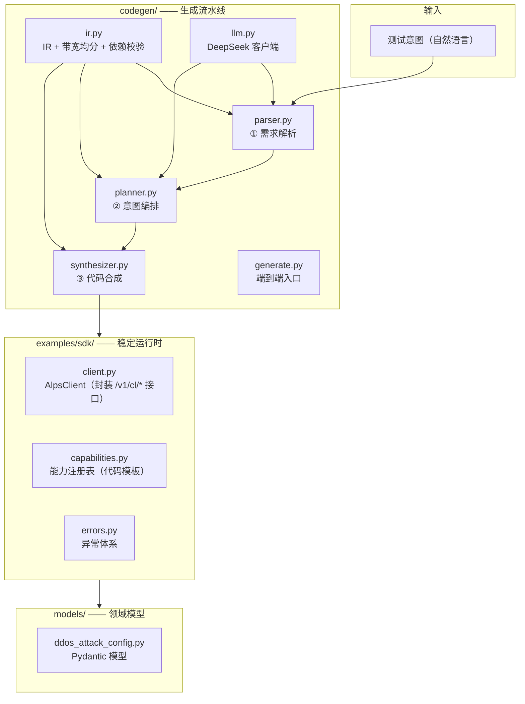
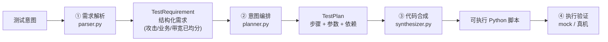

# testcase-gen

面向**信而泰（Xinertel）网络测试仪**的 **AI 测试代码生成系统**：输入一句测试意图，输出一份**可直接执行的信而泰 Python 接口代码**。

```text
输入：测试 udp flood 和 http get flood 混合攻击，攻击总带宽 1Gbps，业务总带宽 2Gbps，时长 200 秒
输出：可执行的 .py 脚本（import AlpsClient，编排 login → 配置攻击/业务 → save → run → 统计 → logout）
```

---

## 一、核心目标

把「测试意图 → 可执行测试代码」这条链路自动化：

- 输入：自然语言测试意图（可含**并发混合攻击** + 业务背景流量）。
- 输出：一个 `.py` 文件，直接 `python xxx.py` 即可驱动测试仪完成整条测试流程。
- 关键：输出的是**代码而非描述**——代码可以真正执行，跑通即验证通过。

---

## 二、技术架构

系统分四层，从「理解」到「可执行」逐层推进：



### 主流程图（数据流）



---

## 三、核心设计决策

1. **输出代码而非 JSON 描述**：代码可自证（跑通 = 验证通过），这是评测「可执行率」能被自动化的前提。
2. **稳定 SDK + 生成的薄脚本**：`AlpsClient` 和领域模型是手写、版本化的稳定层；生成脚本只 `import` 它并编排调用顺序，LLM 永远不碰底层 HTTP/签名/模型。
3. **LLM 只做理解，代码只做确定性工程**：带宽均分、schema 校验、模板渲染、依赖检查全部由代码完成；LLM 只负责「意图 → 结构化需求 → 编排」。

---

## 四、中间表示（IR）

系统内部不直接「意图 → 代码」，而是「意图 → **IR** → 代码」。IR 分两级：

### 4.1 结构化需求 `TestRequirement`

```python
@dataclass(frozen=True)
class AttackSpec:
    type: str              # "udp_flood" | "http_get_flood" | ...
    bandwidth_mbps: int    # 均分后的带宽（确定性代码算出）
    target: dict           # 按类型：{"dest_ip": "11.0.0.1/24"} 或 {"url": "..."}

@dataclass(frozen=True)
class BusinessSpec:
    type: str
    bandwidth_mbps: int    # 业务流量带宽（均分后）

@dataclass(frozen=True)
class TestRequirement:
    name: str
    duration_sec: int
    attacks: tuple[AttackSpec, ...]      # 并发攻击
    businesses: tuple[BusinessSpec, ...] # 业务背景流量
```

> 混合攻击时**带宽平均分配**由确定性代码完成（`allocate_bandwidth`），不让 LLM 做算术。

### 4.2 测试计划 `TestPlan`

```python
@dataclass(frozen=True)
class Ref:
    step: str    # 引用前序步骤的 step_id
    field: str   # 引用其产出字段

@dataclass(frozen=True)
class PlanStep:
    step_id: str
    capability: str          # 对应能力注册表的一项，如 "ensure_attack_profile"
    inputs: dict             # 参数值：字面量 或 Ref（依赖）
    outputs: list[str]       # 本步产出的字段
```

混合攻击的「并发」用 **fan-in** 表达：多个攻击/业务 profile 配置步，最后汇入一个 `build_testcase_info` 步。

---

## 五、能力注册表

`examples/sdk/capabilities.py` 把每类测试操作绑定到 SDK 的一个方法 + 一段代码模板。当前 11 个能力：

| 能力 | 说明 |
|------|------|
| `login` / `logout` | 登录 / 登出（session 由 client 内部自持） |
| `reserve_port` | 自动查询并预留可用端口 |
| `ensure_attack_profile` | **复用优先**：按名匹配已有攻击 profile，否则新建 |
| `ensure_load_profile` | 同上（业务/负载 profile） |
| `create_testcase` | 创建测试用例 |
| `build_testcase_info` | 把前序 profile 组装成 TestcaseInfo（fan-in） |
| `save_testcase` | 保存配置 |
| `run_testcase` | 执行，产出 `instance_id` |
| `get_stats_overview` | 拉统计（引用 run 的 instance_id） |
| `stop_testcase` | 停止 |

每个能力声明 `input_fields` / `output_fields` / `output_expr`（返回值字段提取）+ `template`（Jinja2 调用模板）。

---

## 六、端到端示例

**输入**：

```text
测试 udp flood 和 http get flood 混合攻击，攻击总带宽1Gbps，业务总带宽2Gbps，时长200秒，目的IP 11.0.0.1/24
```

**输出**（生成脚本骨架，完整版见 `outputs/generated_testcase_1.py`）：

```python
from examples.sdk import AlpsClient, ApiError

BASE_URL = 'https://10.99.80.111:7070'
NAME = 'admin'
PASSWORD = 'admin'

def main():
    client = AlpsClient(base_url=BASE_URL, name=NAME, password=PASSWORD, verify=False)
    try:
        client.login()
        client.ensure_attack_profile('udp_flood')       # 复用或新建
        client.ensure_attack_profile('http_get_flood')  # 复用或新建
        client.ensure_load_profile('business')          # 业务流量
        port_id = client.reserve_first_available_port() # 自动查端口
        tc_id = client.create_testcase('...')["result"]["testcase_id"]
        # ATTACKS/BUSINESSES 由合成器从上述 profile 步骤自动收集（含带宽/时长）
        info = client.set_testcase_info(tc_id, '...', attacks=ATTACKS, businesses=BUSINESSES)
        client.save_testcase(tc_id, info)
        instance_id = client.run_testcase(tc_id, '...')["result"]["instance_id"]
        client.get_stats_overview(instance_id)
        client.stop_testcase(tc_id)
    finally:
        client.logout()

if __name__ == "__main__":
    main()
```

其中 `ATTACKS = [{udp_flood 500M}, {http_get_flood 500M}]`、`BUSINESSES = [{business 2000M}]`，带宽由 `1000 ÷ 2` 等确定性计算得出。

---

## 七、目录结构

```
codegen/               # 生成流水线（当前设计的核心）
  ir.py                # IR：TestRequirement / TestPlan + 带宽均分 + 依赖闭环校验
  llm.py               # DeepSeek 客户端（模型名/base_url/api_key 从 .env 加载）
  parser.py            # ① 意图 → TestRequirement
  planner.py           # ② TestRequirement → TestPlan（校验失败回炉重试）
  synthesizer.py       # ③ TestPlan → 可执行 Python 脚本
  generate.py          # 端到端入口（python -m codegen.generate）
examples/
  sdk/                 # 稳定 SDK（AlpsClient + 能力注册表 + 异常）
    client.py          # 封装 /v1/cl/* 接口
    capabilities.py    # 11 个能力的代码模板与元数据
    errors.py          # ApiError / AttackNotFoundError 等
models/
  ddos_attack_config.py  # Pydantic 领域模型（AttackModule / AppModule / TestcaseInfo ...）
tests/                 # 25 个单测 + 端到端执行验证
docs/                  # 设计文档、项目总结、架构图
inputs/
  intent.txt           # 默认意图输入（generate.py 无参时读取）
  xrt_openapi.jsonl    # OpenAPI 定义（扩展 SDK 能力时的参考）
```

---

## 八、快速开始

```bash
# 1. 安装依赖
uv sync

# 2. 配置 .env（模型名与 API key 从 .env 加载）
#    DEEPSEEK_API_KEY=sk-xxx
#    MODEL_NAME=deepseek-flash
#    BASE_URL=https://api.deepseek.com

# 3. 生成（命令行传意图）
python -m codegen.generate "测试 udp flood 和 http get flood 混合攻击，攻击总带宽1Gbps，业务总带宽2Gbps，时长200秒"

#    或读取 inputs/intent.txt
python -m codegen.generate

# 输出：outputs/generated_testcase_1.py
```

运行测试：

```bash
python -m pytest tests/ -q
```

---

## 九、设计文档

- [代码生成系统设计](./docs/代码生成系统设计.md) —— 全新设计的详细方案
- [目标架构对照](./docs/目标架构对照.md) —— 目标 vs 现状的对照与差距分析
- [项目总结](./docs/项目总结.md) —— 项目背景与量化指标
